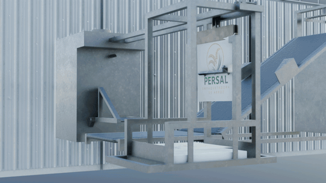
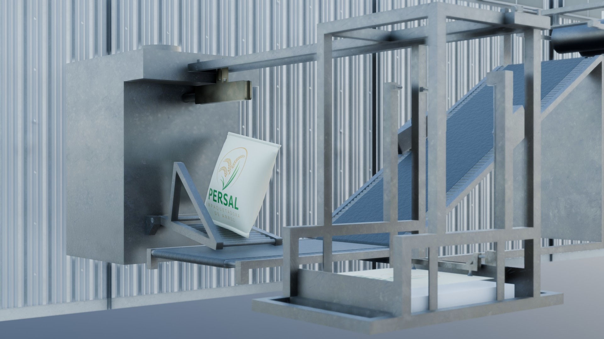
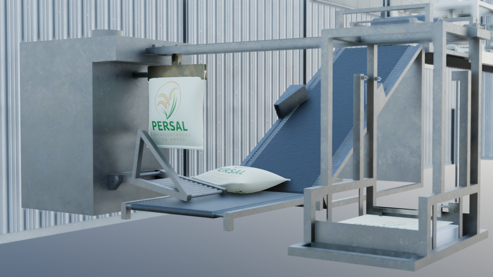
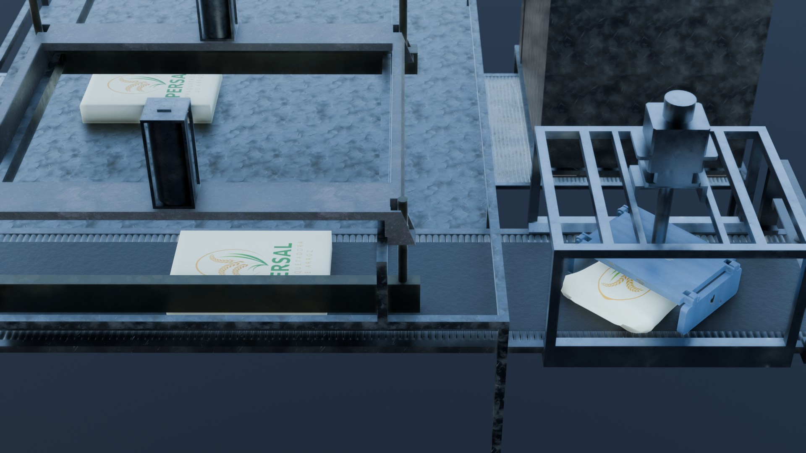
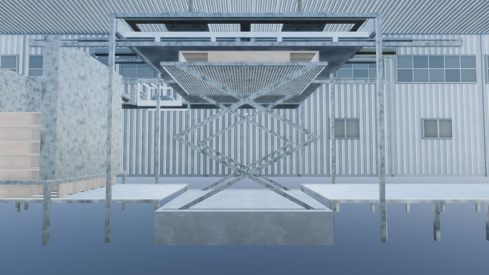
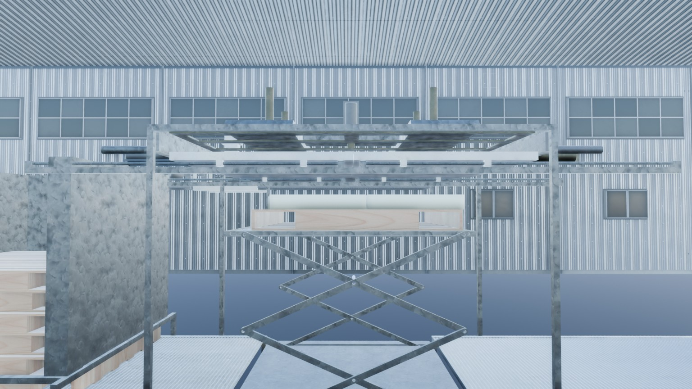

# Palletizer Animation

Short presentation video, rendered in Blender, of a rice bagging and palletizing line for a fictional brand, "Persal".



Full video: [`media/palletizer.mp4`](media/palletizer.mp4) (H.264, 1920×1080, 24 frames per second, 504 frames, 21 s, no audio, 7.95 MB).

## Problem / context

Presentation video for Gabriel Pérez's course project, 2026. Gabriel designed and modelled the machine in SolidWorks; the task here was to turn that mechanical model into a short video that shows how the line works: a bag is filled, drops onto a conveyor, is grouped with other bags and stacked on a pallet by a scissor lift.

This is a visualization of an existing mechanical model, not a built or tested machine. The video shows the intended motion; it does not validate the mechanism.

## How it works

| Stage | Who | Tool |
|---|---|---|
| Mechanical design and modelling of the palletizer | Gabriel Pérez | SolidWorks |
| Animation, materials, lighting and rendering | Javier Solís | Blender |
| Logo of the fictional brand "Persal" ([`media/persal-logo.png`](media/persal-logo.png)) | Javier Solís | Blender |
| Editing of the final video | Javier Solís | FFmpeg |

The animation was rendered shot by shot, each shot exported as a PNG image sequence. What can be confirmed from the metadata Blender stores in every frame:

| Shot | Timeline frames | Frame count | Render resolution | Median render time per frame |
|---|---|---|---|---|
| Scene 1: filling and bag drop | 1 to 288 | 288 | 1920×1080 | 27.7 s |
| Scene 3: grouping, top view | 237 to 283 | 47 | 1920×1080 | 27.1 s |
| Scene 5: scissor lift and pallet | 361 to 529 | 169 | 1536×864 | 12.5 s |

- The 24 frames per second rate is confirmed by the timecode stored in each frame (for example, frame 288 reads 00:00:12:00).
- Scene 5 was rendered at 80 % resolution and scaled to 1920×1080 in the edit, so that shot has less detail than the other two.
- The metadata does not record the render engine, so it is not stated here.
- The project folder contains Alembic caches named `cloth` and `inflating`, which suggests that the bag shapes come from a cloth simulation; this was not checked by opening the Blender file.

## Results and measurements

- [`media/palletizer.mp4`](media/palletizer.mp4): the three shots complete and in order: scene 1 (288 frames, 12.0 s), scene 3 (47 frames, 2.0 s) and scene 5 (169 frames, 7.0 s). Total 504 frames, 21.0 s, 7 950 670 bytes.
- Editing decision: scene 1 is kept complete. Scene 3 covers timeline frames 237 to 283, which overlap the end of scene 1 (frames 237 to 288), so the top view deliberately replays about two seconds of action already seen, from a different angle.
- [`media/preview.gif`](media/preview.gif): 6.5 s of scene 1 at 540×304 and 12 frames per second.
- [`media/frames/`](media/frames/): five representative stills in JPG.

| | |
|---|---|
|  |  |
| Bag dropping from the filling unit | Bag on the conveyor |
|  |  |
| Top view of the grouping area | Scissor lift |
|  | |
| Scissor lift with bags on the pallet | |

## How to reproduce

The Blender files and the mechanical design are not published (see Credits), so the animation cannot be re-rendered from this repository. The final video was assembled from the PNG sequences with this FFmpeg command:

```bash
ffmpeg -framerate 24 -start_number 1   -i scene1/scene_1%04d.png \
       -framerate 24 -start_number 237 -i scene3/scene_3%04d.png \
       -framerate 24 -start_number 361 -i scene5/scene_5%04d.png \
       -filter_complex "[0:v]scale=1920:1080:flags=lanczos,setsar=1,format=yuv420p[a];\
[1:v]scale=1920:1080:flags=lanczos,setsar=1,format=yuv420p[b];\
[2:v]scale=1920:1080:flags=lanczos,setsar=1,format=yuv420p[c];\
[a][b][c]concat=n=3:v=1:a=0[v]" \
       -map "[v]" -an -c:v libx264 -crf 23 -preset slow -pix_fmt yuv420p -r 24 \
       -movflags +faststart -map_metadata -1 palletizer.mp4
```

To check the result: `ffprobe -count_frames -show_entries stream=nb_read_frames,width,height,r_frame_rate palletizer.mp4` should report 504 frames, 1920×1080 and 24/1.

## What I learned and what is missing

- Rendering by shots and keeping the timeline frame numbers in the file names made the edit simple and traceable: every frame in the video can be mapped back to its shot and timeline position.
- Rendering scene 5 at 80 % resolution saved render time (median 12.5 s per frame against about 27 s for the full-resolution shots), at the cost of visible softness after upscaling. A final version should render it at full resolution.
- There is no render of timeline frames 289 to 360 (the folder numbering suggests scenes 2 and 4 that do not exist), so there is a jump between scene 3 and scene 5.
- The video has no audio and no titles.

## Credits

- **Mechanical design and modelling:** Gabriel Pérez, in SolidWorks. Used with permission; his design files (SolidWorks parts and assemblies and their STEP, glb and obj exports) are not included in this repository.
- **Animation, materials, lighting, rendering, the "Persal" logo and video editing:** Javier Solís, in Blender (editing in FFmpeg).
- The background building and some materials come from third-party libraries; they are not included in the repository.
- "Persal" is a fictional brand created for this animation.

## License

Video, images and logo are licensed under [Creative Commons Attribution-NonCommercial-NoDerivatives 4.0 International (CC BY-NC-ND 4.0)](https://creativecommons.org/licenses/by-nc-nd/4.0/). Full legal text in [`LICENSE`](LICENSE).
